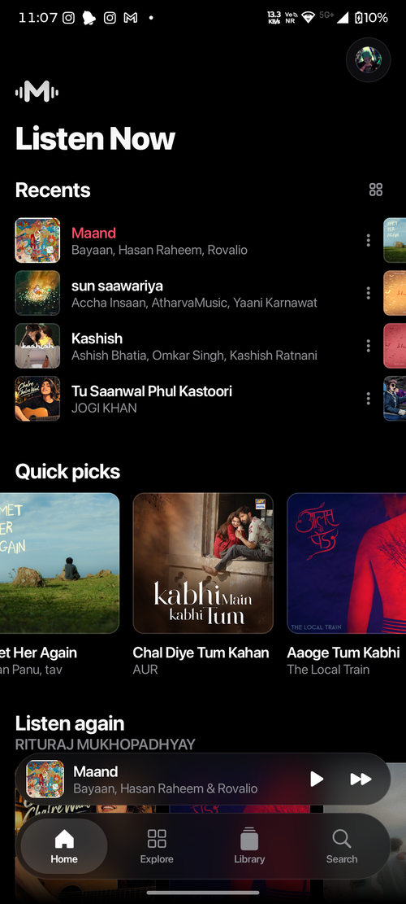
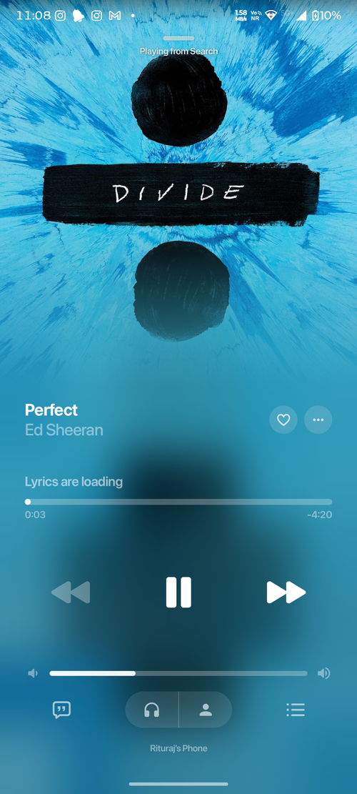
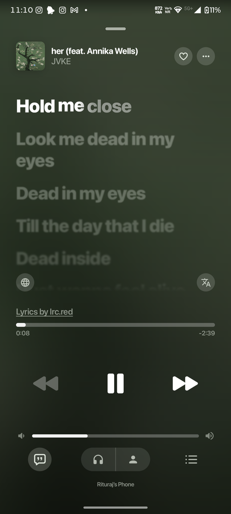

<div align="center">

<br/>
<br/>


# Muvora

### Music moves with you.

<br/>

[](https://github.com/Rituraj-Anos/Muvora/releases)
[](https://github.com/Rituraj-Anos/Muvora/releases)
[](https://github.com/Rituraj-Anos/Muvora/blob/main/LICENSE)
[](https://muvora.pages.dev)

<br/>

[**Download**](#download) · [**Features**](#features) · [**Build**](#building-from-source) · [**Credits**](#credits) · [**Legal**](#disclaimer--legal)

<br/>

</div>

> [!IMPORTANT]
> Muvora is a personal, non-commercial project. It is **not affiliated with, endorsed by, or connected to** YouTube, Google, Spotify, or any service it talks to. It does not host any music. Use it at your own discretion.

---

<div align="center">


<br/>
<br/>


&nbsp;&nbsp;

&nbsp;&nbsp;


<h1><a id="features"></a>Features</h1>

<table>
  <tr>
    <td width="50%" valign="top">

#### Playback
- **Search, browse and play** anything on YouTube Music.
- **Local music library** — play the files already on your device.
- **Offline downloads** — save tracks with embedded metadata.
- **Gapless playback with crossfade**, adjustable 0–12s.
- **Background playback** via a proper foreground media session.
- **Lock-screen & notification controls.**

#### Connectivity & Accounts
- **Sign in with your Google account** for your library and recommendations.
- **Spotify import** — bring in your playlists and Liked Songs.
- **In-app updates** — a prompt appears inside Muvora when a new version is out.

    </td>
    <td width="50%" valign="top">

#### Experience
- **Word-synced lyrics** — word-level highlighting from multiple providers.
- **Dynamic, artwork-driven theming** — colours pulled from the album art.
- **Frosted-glass UI** — translucent bars, Material 3 theming.
- **Animated album canvas** on the now-playing screen.

#### Controls & Tweaks
- **Per-network audio quality** — separate ceilings for Wi-Fi and mobile data.
- **Playback speed** (0.5×–2.0×) and **skip silence**.
- **Sleep timer** — presets or "stop after this track".
- **System equalizer** integration.

    </td>
  </tr>
</table>

</div>

---

<div align="center">

<h1><a id="download"></a>Download</h1>

<a href="https://muvora.pages.dev/download" target="_blank" rel="noopener noreferrer"></a>

Grab the latest signed APK from the **[Releases](https://github.com/Rituraj-Anos/Muvora/releases)** page, or straight from the **[website](https://muvora.pages.dev)**.

Most phones want `Muvora-arm64-v8a.apk`. If that one won't install, use `Muvora-universal.apk`. Sideloading needs "Install unknown apps" enabled for whatever opens the download; Android will prompt you the first time.

</div>

---

<div align="center">

<h1><a id="signing-in"></a>Signing in</h1>

</div>

Sign-in happens inside the app against Google's own login page, so 2FA and passkeys work normally.

1. Open Muvora and tap **Sign in** (or **Skip sign in** to browse without an account).
2. Complete Google login in the in-app page.
3. If your account has more than one channel, pick the one you want and confirm.

Your session is stored encrypted on your device. The app never sees your password.

---

<div align="center">

<h1><a id="building-from-source"></a>Building from source</h1>

</div>

**Requirements:** JDK 21 (Android Studio's bundled JBR works well), the Android SDK with platform 37 and NDK, and the SDK path in `local.properties` (`sdk.dir=...`).

```bash
# Debug APK (for testing)
./gradlew :app:assembleProdDebug

# Build straight onto a connected phone
./gradlew :app:installProdDebug
```

Output lands in `app/build/outputs/apk/prod/debug/`. Two flavors exist, `dev` (`com.ritur.muvora.dev`) and `prod` (`com.ritur.muvora`), so a dev build can sit installed next to the main one.

---

<div align="center">

<h1><a id="credits"></a>Credits</h1>

</div>

Muvora is a fork of **[BitChord](https://github.com/kushagrasinghx/BitChord)** by [kushagrasinghx](https://github.com/kushagrasinghx), used under the GPLv3. Huge thanks to the BitChord authors and to the lyrics and metadata providers their work builds on. All original credits are preserved in [`ADDITIONAL.md`](ADDITIONAL.md).

---

<div align="center">

<h1><a id="disclaimer--legal"></a>Disclaimer & Legal</h1>

</div>

Muvora is an independent, non-commercial, third-party music player. It is **not** associated with Google LLC, YouTube Music, or Spotify.

* **No media hosting:** Muvora does not host, upload, or store any copyrighted music. It only scans local storage or streams from public and user-authenticated APIs.
* **Fair use:** Built for personal, educational, and fair-use purposes. You are responsible for complying with your local copyright laws and the terms of any platform you connect it to.
* **Trademarks:** YouTube, YouTube Music, Google, and Spotify are trademarks of their respective owners.
* **Copyleft:** Muvora is free software under the GPLv3; any redistribution must include the corresponding source under the same license.

See [`DMCA.md`](DMCA.md) for takedown and copyright-contact information.

---

<div align="center">

<h1><a id="license"></a>License</h1>

This project is licensed under the **[GNU General Public License v3.0 (GPLv3)](LICENSE)**.

<br/>

**[muvora.pages.dev](https://muvora.pages.dev)**  ·  Made for listening

</div>
